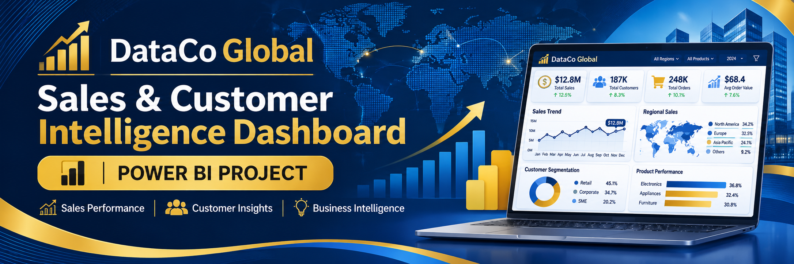
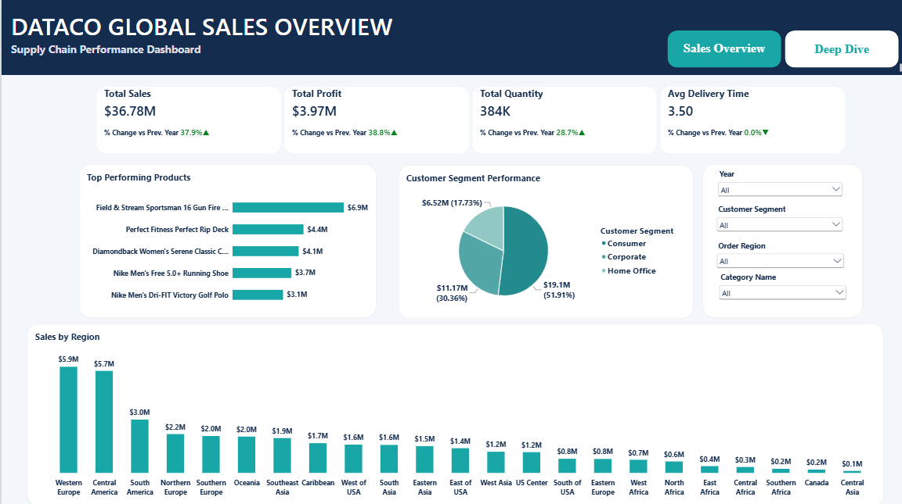

# DataCo Global – Sales & Customer Intelligence Dashboard

**Supply Chain Performance Dashboard | Microsoft Power BI**

## Project Overview

This project focuses on analysing DataCo Global's sales, customer and supply chain performance using Microsoft Power BI.

The objective was to transform raw business data into an interactive dashboard that provides insights into sales performance, profitability, customer segments, product categories, regional performance and delivery operations.

The project involved data cleaning and transformation, data modelling, DAX calculations, time-based analysis and interactive dashboard development.

The final report consists of two pages:

- DataCo Global Sales Overview
- Deep Dive Analysis

## Business Background

DataCo Global operates in a business environment where monitoring sales activities and supply chain performance is important for effective decision-making.

Sales transactions generate information about customers, products, markets, revenue and profitability. Delivery records also provide information about order fulfilment and operational performance.

Analysing these areas together helps stakeholders understand how the business is performing and identify areas that may require attention.

## Business Problem

Without a structured reporting system, it can be difficult for business stakeholders to monitor sales performance, compare profitability across regions and products, understand customer purchasing patterns and evaluate delivery performance.

The business needs a consolidated view of its sales and supply chain data to:

- Monitor key sales and profitability indicators.
- Compare performance across regions and markets.
- Understand product and customer segment contributions.
- Track changes in performance over time.
- Identify potential delivery and operational challenges.

This project addresses these needs through an interactive Power BI dashboard.

## Project Objectives

The main objectives were to:

1. Clean and transform the available dataset using Power Query.
2. Build a structured data model using a star schema.
3. Create a custom date table for time-based analysis.
4. Develop DAX measures for key business indicators.
5. Analyse sales and profit performance across different dimensions.
6. Evaluate customer segment and product performance.
7. Examine year-over-year performance.
8. Analyse delivery performance and late-delivery risk.
9. Develop a two-page interactive Power BI dashboard.
10. Present business information in a clear format that supports decision-making.

## Dashboard Preview

The screenshot below shows the DataCo Global Sales Overview page.

**Explore the full interactive report:**

[Click here to view the full Power BI report](https://app.powerbi.com/view?r=eyJrIjoiNTZmOTg2NTQtZTU4ZS00ZWNhLThlYjktMTZiMjA4OGQxNDg3IiwidCI6ImI5OGY0MWY5LWVlZWYtNDNkMC04MWU3LTQzOTU0MzFjYzkwNiJ9)

**Access the project file:**

[Click here to view or download the Power BI file](dataco-global-sales-analysis.pbix)

## Dataset Overview

The project uses the DataCo Global sales and supply chain dataset.

The data model was organised into five tables:

| Table | Description |
|---|---|
| FactSales | Central table containing sales transaction and operational records |
| DimCustomer | Contains customer-related information |
| DimProduct | Contains product-related information |
| DimLocation | Contains location and regional information |
| DimDate | Custom date table for time-based analysis |

The FactSales table serves as the central fact table, while the dimension tables provide descriptive information for analysing transactions.

## Data Cleaning and Transformation

Data preparation was carried out using Power Query in Power BI.

The preparation process included:

- Reviewing and correcting data types.
- Formatting numerical and percentage fields appropriately.
- Converting Order Item Discount Rate to a percentage data type.
- Formatting Order Item Discount and Benefit per Order as currency values.
- Combining first-name and last-name fields into a Full Name field.
- Preparing the tables for data modelling and analysis.

These steps helped organise the dataset and make the fields suitable for reporting and calculations.

## Data Modelling

A star schema was implemented to organise the data model.

The model consists of:

**Fact Table**
- FactSales

**Dimension Tables**
- DimCustomer
- DimProduct
- DimLocation
- DimDate

The structure supports analysis across customers, products, locations and time.

### Custom Date Table

A custom DimDate table was created to support time-based calculations and comparisons.

It includes:

- Year
- Month
- Quarter
- Month Name
- Week Number
- Day of Week

The date table supports filtering and time-based analysis, including year-over-year comparisons.

## Key Performance Indicators (KPIs)

The dashboard contains four main KPI cards:

| KPI | Purpose |
|---|---|
| Total Sales | Measures overall sales value |
| Total Profit | Measures profit generated |
| Total Quantity | Shows the total quantity recorded |
| Average Delivery Time | Measures average delivery duration |

DAX calculations were also used to support year-over-year performance analysis.

These indicators provide an overview of the business and help users explore performance across different reporting periods.

## Dashboard Development and Analysis

The Power BI report contains two interactive dashboard pages.

### Page 1: DataCo Global Sales Overview

This page provides an executive-level overview of the business.

It includes:

- KPI cards for Total Sales, Total Profit, Total Quantity and Average Delivery Time.
- Sales performance by Region and Market.
- Top-performing Products.
- Customer Segment analysis.
- Year-over-year performance analysis.
- Interactive slicers for Region, Product Category, Customer Segment and Year.

**Purpose of this page:**

To provide a quick overview of business performance and allow users to compare sales and profitability across different business dimensions.

### Page 2: Deep Dive Analysis

This page provides a more detailed examination of sales and supply chain performance.

It includes:

- Sales trends over time.
- Profit analysis by Product Category and Department.
- Late-delivery risk by Region and Category.
- Sales analysis by Customer Segment and Region.

**Purpose of this page:**

To allow users to investigate performance patterns in greater detail and explore areas that may require further business attention.

## Key Areas of Analysis

The dashboard was designed to examine the following business areas:

**Sales Performance**

Reviewing sales across regions, markets and reporting periods to understand how business performance changes over time.

**Profitability**

Comparing profit across product categories and departments to understand where profit is generated.

**Product Performance**

Examining product contributions to sales and identifying products that perform strongly.

**Customer Intelligence**

Analysing customer segments to understand how different groups contribute to overall sales.

**Regional Performance**

Comparing sales performance across regions and markets to identify differences in business activity.

**Delivery Performance**

Examining average delivery time and late-delivery risk to understand operational performance.

## Business Recommendations

Based on the business areas examined in the dashboard, the following actions are recommended for management consideration:

### 1. Strengthen Sales Performance Monitoring

Monitor sales performance across regions and markets regularly. Investigate areas showing weaker sales trends and identify opportunities to improve performance.

### 2. Focus on Profitability, Not Revenue Alone

Evaluate products and departments using both sales and profit indicators. High sales do not automatically translate into high profitability, so pricing, discounts and costs should also be considered.

### 3. Improve Product Performance Decisions

Use product-level analysis to identify strong and weak performers. Maintain effective inventory and marketing strategies for products that contribute positively to business performance.

### 4. Develop Customer Segment Strategies

Use customer segment analysis to understand differences in purchasing behaviour. Develop appropriate marketing and customer engagement strategies for each segment.

### 5. Review Regional Performance

Compare performance across regions and markets. Investigate the reasons behind differences and identify opportunities to improve sales activities in weaker-performing areas.

### 6. Address Delivery Performance Challenges

Monitor average delivery time and late-delivery risk across regions and product categories. Investigate recurring delays and work with relevant operational teams to improve order fulfilment.

### 7. Use Year-over-Year Analysis for Planning

Compare current performance with previous years to identify changes in sales and profitability. Use these comparisons to support budgeting, forecasting and business planning.

## Interactive Dashboard Features

The dashboard includes slicers that allow users to explore the report using different filters:

- Region
- Product Category
- Customer Segment
- Year

These interactive features make it easier to compare business performance and examine specific areas without navigating through separate reports.

## Tools and Techniques Used

### Tools

- Microsoft Power BI
- Power Query
- DAX (Data Analysis Expressions)

### Techniques

- Data cleaning and transformation.
- Data modelling using a star schema.
- Custom date table creation.
- DAX measures and time-based calculations.
- Year-over-year analysis.
- KPI development.
- Interactive dashboard design.
- Sales and supply chain performance analysis.

## Business Value

The dashboard provides a consolidated view of sales, customer and supply chain performance.

It helps business stakeholders:

- Monitor important business indicators.
- Compare performance across regions and markets.
- Understand product and customer contributions.
- Review profitability across departments.
- Explore sales trends over time.
- Monitor delivery performance.
- Identify areas that may require further investigation.

The report provides a foundation for more informed business discussions and data-driven decisions.

## Project Deliverables

The completed project includes:

- Power BI report file (`.pbix`).
- Two-page interactive dashboard.
- Cleaned and transformed data tables.
- Star schema data model.
- Custom DimDate table.
- DAX measures and calculations.
- Sales and supply chain performance analysis.

## Conclusion

The DataCo Global project demonstrates the practical use of Microsoft Power BI to transform, model, analyse and visualise business data.

Through Power Query, star schema modelling, DAX calculations and interactive dashboard development, the project brings together sales, profitability, customer, product, regional and delivery information.

The completed report provides a structured approach to exploring business performance and demonstrates how data analytics can support business reporting, operational monitoring and informed decision-making.
